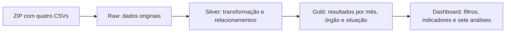

# Especificação — Dashboard com consulta exclusiva à Gold

Status: aprovada e implementada; instruções em [Operação do dashboard Gold](dashboard_gold_operacao.md).
Data: 30/09/2026.

## 1. Objetivo e referências

O dashboard deve responder às sete perguntas de `3_analise.ipynb`, mostrar
indicadores de volume e financeiros e permitir filtros por período, órgão
superior e situação da viagem. Todas as consultas do dashboard devem acessar
somente a camada Gold do PostgreSQL.

Referências: notebook fornecido pelo usuário, suas saídas gravadas e a
[comparação realizada no banco local](comparacao_notebook.md). Esta proposta
é um documento novo; os documentos originais permanecem como referências.

PostgreSQL continua sendo o banco das três camadas. A proposta não inclui
migração para SQLite, escolha de provedor, compra de armazenamento ou exclusão
de Raw e Silver. A capacidade de armazenamento deve ser verificada antes da
carga completa; a tentativa no Render de 1 GB falhou por falta de espaço.

## 2. Arquitetura e responsabilidades

- Raw preserva todos os registros e valores da fonte.
- Silver converte tipos e prepara as informações usadas na análise.
- A carga Gold lê a Silver, materializa os conjuntos abaixo e confere os resultados.
- O dashboard filtra e agrega conjuntos Gold, sem consultar Raw ou Silver.
- O processo de carga pode acessar as três camadas. Isso não faz parte das
  consultas de leitura do dashboard.
- O usuário PostgreSQL usado pelo painel deve ter SELECT na Gold. Se o app
  conservar botões administrativos de criação/carga, essas ações precisam de
  credenciais com permissões próprias, restritas ao responsável. Os testes de
  consulta exclusiva não incluem o processo administrativo de carga.

## 3. Filtros e escopo

| Filtro | Comportamento | Padrão |
|---|---|---|
| Período | Intervalo inclusivo de meses de início da viagem | Todos os meses da fonte |
| Órgão superior | Seleção múltipla por identidade do órgão | Todos os órgãos |
| Situação | Todas ou seleção de uma ou mais situações da fonte | Realizada |

O período tem granularidade mensal nesta versão. Não representa a data do
pagamento, emissão da passagem ou início de cada trecho. Pagamentos, passagens
e trechos recebem mês, órgão superior e situação da viagem à qual pertencem.

A seleção deve afetar todos os indicadores, tabelas, gráficos, rankings e
exportações. Rankings são recalculados depois dos filtros. Aplicar os filtros
antes de selecionar os maiores resultados, nunca sobre um ranking global salvo.

Exibir o recorte no topo: `Jan–jun/2025 · Todos os órgãos · Realizada`.
Situações, órgãos e meses disponíveis devem ser obtidos da Gold. Situações
distintas da fonte não serão unificadas silenciosamente. Valores de órgão
ausentes são apresentados como `Órgão não informado` e continuam selecionáveis.

O filtro usa o órgão superior da viagem. A pergunta sobre órgão pagador mantém
essa dimensão como resultado: identifica quem pagou pelas viagens selecionadas.
Órgão pagador e órgão superior não devem ser tratados como equivalentes.

## 4. Regras de cálculo

- Valor líquido = diárias + passagens + outros gastos − devolução.
- Duração inclusiva = data final − data inicial + 1; viagem no mesmo dia dura 1 dia.
- Média por viagem = soma do valor líquido / quantidade de viagens.
- Média por pagamento = soma dos pagamentos / quantidade de pagamentos.
- Médias são calculadas a partir de totais e contagens; nunca somar ou tirar
  média simples de médias de grupos.
- Valores monetários permanecem NUMERIC no PostgreSQL e Decimal nos cálculos
  Python até a apresentação. Não arredondar os totais intermediários.
- Não somar valores de viagem, pagamento e passagem entre si: são medidas distintas.
- Destino é o texto completo do campo `destinos`, conforme o notebook, sem dividir
  viagens com múltiplas cidades em várias linhas para essa análise.
- Manter a categoria de transporte `Inválido`, conforme a fonte. Não excluir
  esses trechos dos indicadores ou rankings.
- Exibir valores ausentes de UF e destino como não informados, sem inventar
  localidade ou descartar os registros. O agrupamento deve conservar a identidade
  original do valor, mesmo que o rótulo de apresentação seja simplificado.
- Evitar multiplicar valores em JOINs de vários detalhes: agregar cada entidade
  por viagem antes de combiná-las para produzir o resumo geral.
- Rankings devem ter desempate estável. Para custos/médias iguais, ordenar pela
  identidade da categoria; para duração, ordenar por duração DESC, custo DESC,
  identificador da viagem ASC. Identificadores devem preservar zeros à esquerda.

## 5. Indicadores do painel

| Indicador | Origem na Gold | Cálculo no recorte |
|---|---|---|
| Viagens | Resumo geral | SUM(qtd_viagens) |
| Pagamentos | Resumo geral | SUM(qtd_pagamentos) |
| Passagens | Resumo geral | SUM(qtd_passagens) |
| Trechos | Resumo geral | SUM(qtd_trechos), incluindo Inválido |
| Valor líquido | Resumo geral | SUM(valor_total_liquido) |
| Média por viagem | Resumo geral | Valor líquido / viagens |
| Total pago | Resumo geral | SUM(valor_pagamentos) |

As quatro contagens da base completa são 341.860 viagens, 606.916 pagamentos,
167.260 passagens e 763.349 trechos. Esses valores são esperados somente com
todos os meses, todos os órgãos e todas as situações. Não exibi-los como valores
fixos quando o recorte for diferente. Com Realizada, o total esperado de trechos
é 755.885.

## 6. Conjuntos Gold necessários

Os nomes abaixo são propostos. Cada conjunto agregado deve possuir uma tabela
materializada e uma view de referência com a mesma consulta sobre a Silver.
As views servem à conferência da carga; o dashboard consulta as tabelas.

As dimensões comuns são `mes_inicio`, código/nome do órgão superior e `situacao`.
A identidade de agrupamento deve preservar valores nulos e códigos distintos;
não depender apenas de nomes ou concatenar campos de forma ambígua.

| Conjunto | Uma linha por | Medidas e informações |
|---|---|---|
| `gold.resumo_viagem_mes` | Dimensões comuns | Contagens das quatro entidades, valores da viagem, pagamentos e duração total inclusiva |
| `gold.resumo_destino_mes` | Dimensões comuns + texto do destino | Quantidade de viagens e soma do valor líquido |
| `gold.gold_pagamento_resumo` | Dimensões comuns + nome do órgão pagador + tipo de pagamento | Quantidade de pagamentos e total pago |
| `gold.gold_trecho_resumo` | Dimensões comuns + transporte + UF de destino original | Quantidade de trechos |
| `gold.viagens_duracao` | Viagem candidata ao ranking | ID, dimensões comuns, início, fim, duração inclusiva e valor líquido |

Para `viagens_duracao`, guardar as cinco primeiras viagens de cada grupo de
dimensões comuns, com o mesmo desempate utilizado pelo painel. Ao selecionar
qualquer união desses grupos, as cinco primeiras do recorte estarão entre as
candidatas armazenadas. Essa redução é válida porque os filtros desta versão
só selecionam meses, órgãos e situações completos. Filtros futuros por dia,
destino ou outro atributo exigem rever essa estratégia. Viagens sem duração
válida não participam dessa lista, mas permanecem nas contagens aplicáveis.

Não materializar apenas os cinco maiores órgãos ou os três maiores destinos
globais: isso impediria recalcular corretamente os rankings após os filtros.

Os agrupamentos do notebook, com 655 linhas de pagamento e 201 de trecho, são
obtidos ao reunir meses e órgãos e filtrar Realizada. As tabelas propostas
adicionam dimensões e podem ter mais linhas; o teste deve comparar seus resultados
reagrupados com a referência, além de conferir cada tabela com sua própria view.

## 7. Sete perguntas e apresentação

| Pergunta | Conjunto consultado | Critério e apresentação |
|---|---|---|
| 1. Quais os cinco órgãos com maior custo total? | Resumo geral | Agrupar por órgão superior; somar valor líquido; cinco maiores |
| 2. Quais os três destinos com maior custo médio? | Resumo de destinos | Reagrupar por destino; exigir pelo menos 100 viagens no recorte; calcular total / quantidade |
| 3. Qual a viagem mais longa e seu custo? | Candidatas de duração | Selecionar as cinco maiores após os filtros; destacar a primeira com ID, datas, órgão e custo |
| 4. Qual tipo de pagamento tem maior valor médio? | Resumo de pagamentos | Agrupar por tipo; SUM(total_pago) / SUM(qtd_pagamentos) |
| 5. Qual transporte é mais usado? | Resumo de trechos | Agrupar por transporte; quantidade e participação, incluindo Inválido |
| 6. Qual UF de destino é mais frequente? | Resumo de trechos | Agrupar por UF; mostrar as dez maiores |
| 7. Qual órgão pagou mais? | Resumo de pagamentos | Agrupar por nome do órgão pagador; somar total pago; cinco maiores |

Preservar também a evolução mensal de quantidade e valor líquido e o ranking
de média por viagem do painel atual, calculados pelo resumo geral. Nesta proposta,
o ranking de média passa a usar órgão superior, para acompanhar o filtro comum;
essa mudança deve ser indicada na interface e na documentação. O valor mínimo
de viagens informado pelo usuário afeta somente esse ranking adicional.

Cada análise deve oferecer pergunta, tabela, gráfico e conclusão baseada no
recorte atual. Se não houver dados, mostrar uma mensagem informativa sem zeros
que sugiram dados existentes. Se nenhum destino alcançar 100 viagens, informar
que não existe grupo elegível. Evitar divisão por zero e conclusões sem vencedor.

Organização sugerida: filtros no topo, quatro cartões de volume, indicadores
financeiros e abas para visão geral e sete perguntas. Todas as áreas devem
mostrar o mesmo escopo selecionado. Ao trocar situação, títulos e conclusões
acompanham a seleção, sem continuar afirmando que são somente viagens realizadas.

## 8. Pré-requisitos na Silver

A implementação atual rejeita 26.659 trechos com transporte Inválido e calcula
duração sem acrescentar um dia. Essas regras precisam ser alinhadas à referência
antes da nova Gold. Converter a duração apenas na carga Gold é aceitável se a
diferença ficar explícita no contrato dos campos; o campo de duração consumido
pelo painel deve ser inclusivo.

Para esta fonte, conferir as mesmas contagens Raw/Silver nas quatro entidades,
664 datas de emissão vazias convertidas para NULL e pagamentos iguais nas duas
camadas. Auditoria de problemas pode coexistir com preservação do registro, mas
a categoria Inválido não é motivo para retirar o trecho da Silver de análise.

## 9. Carga, atualização e integridade

- Materializar todos os conjuntos Gold em uma única transação a partir de um
  snapshot consistente da Silver. Validar antes do commit.
- Preservar a Gold anterior se a carga falhar. Nunca publicar parte dos conjuntos.
- Confirmar igualdade de contagens e conteúdo entre tabelas e views de referência,
  e reconciliar totais com a Silver. Igualdade de linhas sozinha não comprova valores.
- Verificar idempotência: uma segunda carga com a mesma origem produz os mesmos
  resultados e não acrescenta duplicatas.
- Registrar data da carga, identificação da fonte, contagens e resultado das
  conferências na Gold, para o painel ler sem depender de arquivos temporários.
- Cache de leitura com prazo definido e botão Atualizar dados. Limpar o cache
  e consultar novamente após uma carga bem-sucedida, sem exigir reboot.
- Alterações nos filtros usam os dados Gold; não iniciam extração ou transformação.
- A migração da Gold atual deve preservar a versão existente até validação da
  nova estrutura. Não apagar estruturas antigas automaticamente durante o deploy.

## 10. Critérios de aceitação

Com todos os meses/órgãos e situação Realizada, reproduzir as listas completas
gravadas no notebook e seus resultados principais:

| Conferência | Resultado esperado |
|---|---|
| Maior custo por órgão superior | Justiça e Segurança Pública: R$ 485.748.241,43 |
| Maior média por destino | Brasília/DF, Brasília/DF: 283 viagens e R$ 27.401,80 |
| Maior duração | ID 0000000000020699856: 384 dias e R$ 0,00 |
| Maior média por pagamento | DIÁRIAS: 400.364 pagamentos e R$ 2.078,79 |
| Transporte mais usado | Veículo Oficial: 385.734 de 755.885 trechos |
| Transporte Inválido em Realizada | 26.523 trechos |
| UF mais frequente | São Paulo: 81.727 trechos |
| Maior pagador | Fundo Nacional de Segurança Pública: R$ 278.288.685,42 |
| Grupos de pagamento no formato do notebook | 655 |
| Grupos de trecho no formato do notebook | 201 |

Com situação Todas, conferir as quatro contagens completas e a soma dos
pagamentos de R$ 1.194.365.457,37. Com filtros combinados de mês, órgão e
situação, comparar cada indicador e ranking com uma consulta independente
direta à Silver executada apenas nos testes de validação.

Testar também: período sem resultados, órgão sem identificação, múltiplas
situações, viagem no mesmo dia, empate no ranking, transporte Inválido,
destino abaixo do mínimo e falha da carga com preservação da Gold anterior.

Um teste de execução do dashboard deve funcionar com usuário que tenha apenas
SELECT na Gold, confirmando que nenhuma leitura de Raw/Silver é necessária.
As views de referência que leem Silver não devem ser usadas por esse usuário.

## 11. Entrega prevista

DDL e carga dos conjuntos Gold, ajustes necessários da Silver, consultas do
dashboard, filtros, testes e evidências de comparação. Atualizar documentação
com as regras finais e registrar a relação desta proposta com as referências.
Implementação e publicação serão etapas posteriores à revisão desta especificação.

## 12. Decisão posterior durante a implementação

O usuário aprovou esta especificação e, ao definir a operação administrativa,
escolheu **Somente carga pelo terminal, sem login no app**. Essa decisão substitui
os trechos que contemplam botões administrativos no dashboard. A interface
publicada passa a ter somente leitura, filtros, atualização do cache e exportação.
Criação e carga são executadas pelos scripts no ambiente de processamento.

## 13. Ajuste de apresentação aprovado

Por solicitação do usuário, período, órgão superior e situação ficam na barra
lateral. O painel principal conserva o resumo textual do recorte selecionado.
